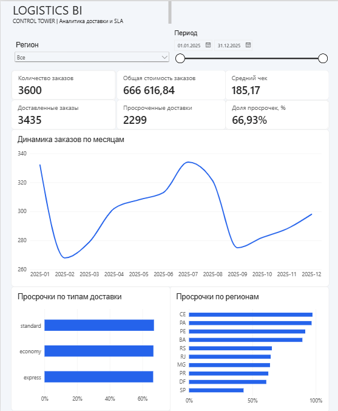
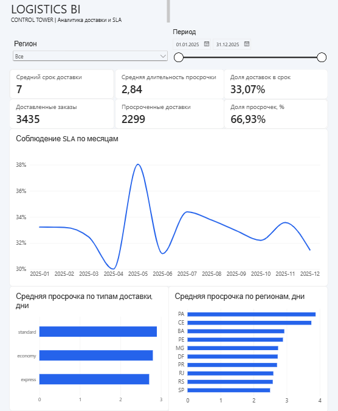
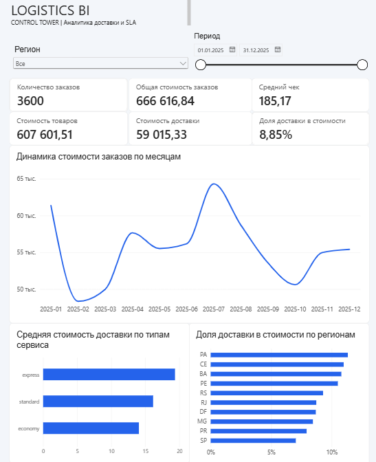
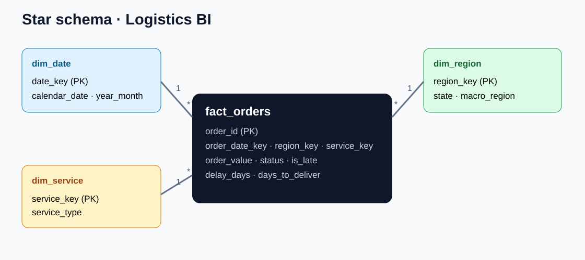

# Logistics BI Control Tower

**BI / DWH / ETL / Business Analysis · учебный консалтинговый кейс**

Аналитическая система для мониторинга заказов, сроков доставки и структуры стоимости логистики. В рамках проекта выполнены анализ требований, проектирование витрины данных, ETL, SQL-аналитика, тестирование и интерактивная отчётность в **Power BI Desktop**.

> **О происхождении данных:** исходные 3 600 заказов сгенерированы для учебного проекта. Компания Northstar Commerce, интервью с заказчиком и согласование требований — **смоделированы**; это не коммерческое внедрение. Скриншоты ниже получены при ручной сборке отчёта в Power BI. Бинарный файл `.pbix` добавляется отдельно из Power BI Desktop (он не содержится в исходном учебном ZIP).

## Power BI — 3 страницы отчёта

### 1. Logistics Overview

Общие KPI, количество заказов по месяцам, доля просрочек по регионам и типам доставки. Общие фильтры: **регион** и **диапазон дат**.



### 2. Delivery Performance

Показатели соблюдения сроков доставки (SLA), средний срок доставки, среднее число дней опоздания и сравнительный анализ задержек.



### 3. Cost & Business Analytics

Стоимость заказов, стоимость товаров, стоимость доставки, средний чек и региональный анализ доли доставки в стоимости заказа.



**Открыть файл Power BI:** `powerbi/Logistics_BI_Control_Tower.pbix` — после добавления локально сохранённого файла. Если его ещё нет в вашей копии проекта, [инструкция по сборке](powerbi/REPORT_STRUCTURE.md) содержит состав всех страниц, меры и контрольные значения. Для быстрого просмотра без Power BI доступен также [автономный HTML-дашборд](dashboard/overview.html).

## Задача и требования

**Бизнес-проблема:** условный маркетплейс не имеет единой аналитики соблюдения обещанных клиенту сроков доставки. Руководителям нужен отчёт, который позволяет ответить на вопросы:

- Как меняется количество заказов и доля своевременных доставок по месяцам?
- Какие регионы и типы доставки характеризуются наиболее высокими долями просрочек?
- Сколько дней длится доставка и на сколько дней опаздывают просроченные заказы?
- Какую часть общей стоимости заказа составляет доставка?

**Роль в учебном проекте:** BI-аналитик / BI-разработчик — сценарий сбора требований, словарь данных, модель хранилища, ETL, SQL, меры DAX, отчёт и проверки.

Документы: [BRD](docs/Business_Requirements.docx) · [техническое задание](docs/Technical_Specification.docx) · [словарь данных](docs/DATA_DICTIONARY.md) · [матрица требований](docs/REQUIREMENTS_MATRIX.csv) · [BPMN 2.0](bpmn/logistics_process.bpmn) · [UAT](docs/POWER_BI_VALIDATION.md).

## Технологии

| Область | Реализация |
|---|---|
| BI и аналитика | Power BI Desktop, DAX, интерактивные фильтры, HTML-дашборд |
| SQL | JOIN, GROUP BY, CTE, подзапросы, `LAG`, `ROW_NUMBER` |
| DWH | Схема «звезда», один факт (`fact_orders`) и три измерения |
| ETL | Python 3.10+, `csv`, `sqlite3`, загрузка и валидация CSV |
| СУБД | SQLite (готовое хранилище), схема для PostgreSQL |
| Бизнес-анализ | BRD, Data Dictionary, технические задания, BPMN 2.0, UAT |
| Представление результатов | Excel-аудит KPI, презентация PowerPoint |
| Тестирование | 12 автоматических тестов + ручные проверки фильтров Power BI |

## Архитектура и модель данных




**Гранулярность:** одна строка в `fact_orders` соответствует одному заказу; позиции заказа агрегируются до загрузки факта. Связи **1 → \***, однонаправленная фильтрация из измерений в факт:

- `dim_date[date_key]` → `fact_orders[order_date_key]`;
- `dim_region[region_key]` → `fact_orders[region_key]`;
- `dim_service[service_key]` → `fact_orders[service_key]`.

### Основные метрики (все регионы, 2025 год)

| Показатель | Значение |
|---|---:|
| Количество заказов | 3 600 |
| Доставлено | 3 435 |
| Просрочено | 2 299 |
| Доля просроченных доставок | 66,93% |
| Доля доставок в срок | 33,07% |
| Суммарная стоимость заказов | 666 616,84 |
| Стоимость товаров | 607 601,51 |
| Стоимость доставки | 59 015,33 |
| Доля доставки в стоимости заказов | 8,85% |
| Средний чек | 185,17 |

*Денежная единица демонстрационного набора условная.* Сумма заказов **не является подтверждённой выручкой**, а `freight_value` нельзя без дополнительных данных считать себестоимостью доставки.

**Правило SLA:** просроченный заказ — доставленный после обещанной даты. Отменённые заказы исключаются из числителя и знаменателя доли просрочек. Средняя длительность просрочки рассчитывается только по опоздавшим доставленным заказам.

## Краткие аналитические выводы

- В демонстрационном наборе **66,93%** доставленных заказов приходят позже обещанного срока; это сигнал для анализа SLA по сегментам.
- Среди регионов выделяется **CE**: 153 просрочки из 157 доставленных заказов (**97,45%**). Следующий шаг бизнес-аналитика — проверить состав заказов, условия доставки и объём выборки, а не сразу делать вывод о причине.
- Доставка составляет **8,85%** общей суммы заказов. Метрика помогает сравнивать структуру суммы по регионам и сервисам, но не характеризует прибыльность перевозчика.

Все выводы относятся исключительно к **синтетическому учебному датасету**.

## Как запустить

Для воспроизведения ETL и тестов достаточно **Python 3.10+** (в стандартном сценарии сторонние пакеты не нужны):

```powershell
cd logistics-bi-control-tower
python -m etl.generate_demo
python -m etl.build_warehouse
python -m unittest discover -s tests -v
```

Откройте файл `dashboard/overview.html` в браузере, чтобы посмотреть HTML-версию. Данные для Power BI находятся в `data/powerbi/` (четыре CSV). В Power Query при проблемах с точкой в десятичных значениях используйте преобразование типа **с языковым стандартом English (United States)**.

**Важно при переносе `.pbix`:** в Power Query пути к CSV могут быть абсолютными. На другом компьютере откройте «Преобразовать данные» → настройки шага «Источник» и укажите путь к CSV из `data/powerbi/`, затем обновите модель.

**Power BI:** откройте локальный `.pbix` или соберите отчёт по [проверенной структуре](powerbi/REPORT_STRUCTURE.md), используя [список мер DAX](powerbi/MEASURES_PORTFOLIO.dax) и [базовую инструкцию импорта](powerbi/POWER_BI_STEP_BY_STEP.md). Файл `.pbix` необходимо сохранить самостоятельно в `powerbi/`.

## Проверки качества

Проверено локально: **12/12 автоматических тестов пройдено** (`unittest`). Они охватывают уникальность заказов, целостность ключей, расчёт стоимости заказа, SLA, экспорт витрин и выполнение SQL-запросов.

Вручную при сборке Power BI проверены фильтры и KPI:

| Сценарий | Заказы | Сумма заказов | Доставлено | Просрочено |
|---|---:|---:|---:|---:|
| Все регионы, весь 2025 год | 3 600 | 666 616,84 | 3 435 | 2 299 |
| Регион CE, 01.01–30.06.2025 | 72 | 13 152,17 | 67 | 65 |

При выбранном CE за первое полугодие доля просрочек — **97,01%**. Подробности: [Power BI UAT / checklist](docs/POWER_BI_VALIDATION.md).

## Структура репозитория

```text
logistics-bi-control-tower/
├── assets/              # скриншоты трёх страниц и схема DWH
├── bpmn/                # схема бизнес-процесса BPMN 2.0
├── dashboard/           # автономный интерактивный HTML-отчёт
├── data/                # demo CSV, SQLite DWH, витрины Power BI
├── docs/                # BRD, ТЗ, словарь данных, тест-кейсы
├── etl/                 # генерация, загрузка, нормализация Olist
├── excel/               # Excel-аудит метрик
├── powerbi/             # DAX, инструкции и добавляемый .pbix
├── presentation/        # презентация для условного заказчика
├── sql/                 # схемы SQLite/PostgreSQL, SQL-анализ
├── tests/               # 12 unit-тестов
└── README.md
```

## Дополнительно: открытый датасет Olist

В качестве следующего этапа можно использовать [Olist Brazilian E-Commerce](https://www.kaggle.com/datasets/olistbr/brazilian-ecommerce) (в архив не включён; проверьте условия использования). Для подготовки исходных CSV предусмотрен `etl/normalize_olist.py`, однако типы сервиса `economy / standard / express` не восстанавливаются из исходного Olist и в этой адаптации задаются как `not_provided`.

## Ограничения кейса

- Синтетические данные и условный клиент; **нет коммерческого внедрения** и интервью с реальными представителями бизнеса.
- Готовая Power BI-модель собрана пользователем в Desktop, но `.pbix` не передавался вместе с исходным архивом; перед публикацией необходимо добавить свой файл.
- Числовые показатели и демонстрационные выводы нельзя экстраполировать на реальные компании.
- PostgreSQL представлен схемой и упражнениями; основной работающий пайплайн использует SQLite.

---

*Проект для портфолио BI / Big Data стажёра: акцент на SQL, DWH, ETL, сборе и формализации требований, визуализации и тестировании.*
